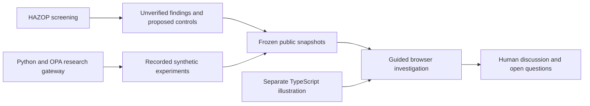

# Agentic Process Safety (APS)

**Permission is only the first question.** APS is an open-source research and learning workspace for examining what must hold when an AI agent acts within a coordinated workflow: the right role, current approval, task-bound context, bounded delegation, and a defensible reason to proceed.

[**Explore the live app**](https://safetymp.github.io/Agentic-Process-Safety/) · [Start the guided investigation](docs/USER_GUIDE.md) · [Project vision](docs/VISION.md) · [Documentation](docs/README.md)

[](https://github.com/SafetyMP/Agentic-Process-Safety/actions/workflows/repository-checks.yml)
[](https://github.com/SafetyMP/Agentic-Process-Safety/actions/workflows/deploy-pages.yml)
[](LICENSE)

## The problem APS makes tangible

A purchase worker has permission to use its tool and stays within budget. Finance approved the purchase, but its request reaches the execution boundary **61 logical seconds later**, after the modeled approval has expired. One control bundle permits the request; another holds it. The purchase is still outstanding.

APS connects that concrete situation to the next human question: **what evidence or authority would justify a different action?** Compare the same request, inspect the causal path, change one condition, and form a position that preserves supporting evidence, uncertainty and disagreement.

The project applies hazard and operability (**HAZOP**) analysis to AI agents and multi-agent systems. Its procurement setting makes dependencies between demand, inventory, supplier selection, finance and purchase visible. It is useful for engineers examining agent controls, researchers inspecting the method and evidence, and reviewers discussing what remains unresolved.

## Try the experience

The [live app](https://safetymp.github.io/Agentic-Process-Safety/) needs no account, API key, paid inference, installation or backend.

1. Open the approval case and **Run comparison**. B checks tool permission and spend; C adds lifecycle conditions. Both receive the same request and starting state.
2. Follow the decision path, then choose **Try 59 seconds** and run again. The original comparison remains available. C now permits the request because the approval is current.
3. Choose **Form a position**. A recommendation opens a relevant evidence request, review question or eligible hypothetical recovery. Attach the modeled check or a related recorded event, explain the rationale, and state what would change your mind.

Five connected views support that investigation: **Start here → Case Lab**, with **Hazard study**, **Controls** and **Evidence** available as supporting inspections. The [user guide](docs/USER_GUIDE.md) covers all nine cases, saved discussions, exports and the distinction between a new request and a retained result.


The guided experience was deployed on **2026-11-14** through [PR #32](https://github.com/SafetyMP/Agentic-Process-Safety/pull/32), at commit [`3ddc4ae`](https://github.com/SafetyMP/Agentic-Process-Safety/commit/3ddc4ae9a0dc42c5af98fa7818121cf18a1b364f). Its [deployment workflow](https://github.com/SafetyMP/Agentic-Process-Safety/actions/runs/43645203614) and 233-check browser run passed. This is a dated implementation result; badges and later runs describe subsequent revisions.

## What the evidence means

| Material | What it supports | What it does not establish |
| --- | --- | --- |
| Illustrative browser comparison | How the fixed model's checks respond to the selected request | A live gateway decision, real purchase or complete business outcome |
| Frozen recorded experiments and replay | The retained synthetic trial's actual recorded calls and outcomes | That an edited browser request was executed in that trial |
| HAZOP findings and proposed controls | Questions, possible deviations and control mappings to investigate | Verified hazards, approved requirements or validated risk ratings |
| Human discussion | A recommendation, rationale, sources, uncertainty and dissent | Operational authorization or independent verification of the cited evidence |

All hazards remain unverified, requirements proposed and risk ratings unset in the published fixtures. No real purchase or payment is made. The app does not establish production safety, safety certification, or that HAZOP outperforms another review method. Conventional systems can implement the same lifecycle checks. See the [vision and research questions](docs/VISION.md), [methodology](docs/METHODOLOGY.md) and [threat model](docs/THREAT_MODEL.md).

## Run locally

For the browser app, use **Node.js 22.18+** and npm from the repository root. There is one root lockfile.

```sh
git clone https://github.com/SafetyMP/Agentic-Process-Safety.git
cd Agentic-Process-Safety
npm ci
npm run demo:dev
```

Open the local URL printed by Vite. To inspect the production build locally:

```sh
npm run demo:build
npm run demo:preview
```

The separate research implementation requires **Python 3.11+** and **OPA 1.x** on `PATH`:

```sh
python3 -m venv .venv
.venv/bin/pip install -r requirements.lock
npm ci
npm run demo
```

The browser app never calls this Python/OPA gateway. See [Phase 2 operations](docs/PHASE2_OPERATIONS.md) for setup and policy workflows, and [Phase 3 operations](docs/PHASE3_OPERATIONS.md) for experiments, offline dependencies and evidence inspection.

## Repository map



| Location | Responsibility |
| --- | --- |
| [`apps/aps-demo/`](apps/aps-demo/) | React/TypeScript guided workspace; [browser model](apps/aps-demo/src/domain/README.md) and [fixture provenance](apps/aps-demo/src/fixtures/README.md) |
| [`packages/engine/`](packages/engine/) · [`schemas/`](schemas/) · [`examples/`](examples/) | Deterministic HAZOP screening, review contracts and authored examples |
| [`packages/simulator/`](packages/simulator/) | Procurement orchestrator and simulated workers |
| [`packages/governance/`](packages/governance/) · [`policies/v1/`](policies/v1/) | Research gateway, OPA/Rego controls, experiments and assurance tooling |
| [`tests/`](tests/) · [`scripts/`](scripts/) | Regression tests, integrity checks and evidence verification |
| [`docs/`](docs/README.md) | Current guides, technical references and clearly classified historical records |

## Verify a change

```sh
node scripts/verify-repository-readiness.mjs
npm run demo:production:check
npm run demo:fixtures:check
npm run demo:lint
npm run demo:typecheck
npm run demo:test
npm run demo:build
npm run demo:static:check
```

Real-browser verification uses `npm run demo:e2e` with the pinned Playwright browser. Follow the browser setup in [Contributing](CONTRIBUTING.md) and the [development reference](docs/DEVELOPMENT_REFERENCE.md). Root `npm test` invokes the research gateway and needs the Python/OPA setup. Fresh acceptance must bind the exact source, workflow, artifact and reviewed screenshots; historical receipts cannot qualify new source.

## Contribute and discuss

Start with [Contributing](CONTRIBUTING.md), [Support](SUPPORT.md), the [Code of conduct](CODE_OF_CONDUCT.md), and [Security reporting](SECURITY.md). Useful contributions improve causal explanations, evidence mappings, reproducibility, accessibility and the quality of open questions. The [vision](docs/VISION.md) distinguishes current capability from research still needed.

Coding agents should start with [AGENTS.md](AGENTS.md) for repository navigation and contribution constraints. Cite a specific revision using the [citation metadata](CITATION.cff); research results and interface revisions have different evidence boundaries.

Part of the [SafetyMP portfolio](https://github.com/SafetyMP). Project-owned material is offered under [Apache-2.0](LICENSE), with third-party terms preserved. The [open-source readiness record](docs/open-source-readiness.md) documents remaining ownership and governance questions; a license is not certification of industrial suitability.
