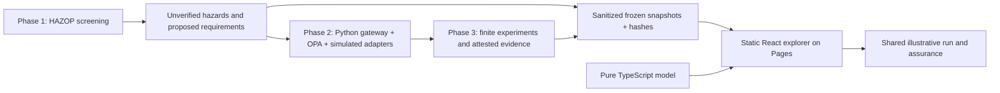

# Agentic Process Safety — Phases 1, 2 and 3

Research sandbox; hazards remain unverified and human approvals pending. See [Contributing](CONTRIBUTING.md), [Code of conduct](CODE_OF_CONDUCT.md), [Security](SECURITY.md) and [Support](SUPPORT.md). Project-owned material is offered under [Apache-2.0](LICENSE), subject to preserved third-party terms and the pending source-data/rights review in the [readiness audit](docs/open-source-readiness.md). No remote settings, release rights or industrial suitability are certified.

The static demonstration targets [safetymp.github.io/Agentic-Process-Safety](https://safetymp.github.io/Agentic-Process-Safety/). **Deployment has not been verified.** The isolated React/TypeScript app in `apps/aps-demo` runs entirely in the visitor's browser: no account, API key, paid inference, backend, telemetry or installation is required. The original Python/OPA research implementation remains separate.

## Static demonstration

Explore an interactive procurement topology, the HAZOP Lab's 96 unverified findings and 16 authored scenarios, nine governance stories, a deterministic swarm simulator, and source-linked assurance. The walkthrough follows objective → unsafe operation → HAZOP deviation → a blocked SIMULATED gateway action → that same SIMULATED outcome in assurance. Details link hazards, proposed controls, test selectors and recorded trials. Keyboard entity buttons accompany the topology; charts have data tables. Theme choices are system/light/dark and persist locally.

The exact browser stories are normal authorized transactions, unauthorized tool execution, excessive spending, recursive delegation, missing approval, replay attempts, stale approval, conflicting agent objectives and compromised shared context. Arms A/B/C illustrate baseline, conventional tool/spend access checks and HAZOP-informed checks. Start schedules logical steps; Pause stops advancement; Step advances one logical tick; Reset and configuration switches isolate state. Seeds are bounded integers. Human review has distinct approve/deny outcomes. These decisions do not call OPA or authorize real operations.



For local frontend work use Node 22.18+ and the single root lockfile:

```sh
npm ci
npm run demo:dev
npm run demo:fixtures:check
npm run demo:fixtures:audit
npm run demo:production:check
npm run demo:lint
npm run demo:typecheck
npm run demo:test
npm run demo:build
npm run demo:static:check
mkdir -p .harness/tmp
PLAYWRIGHT_BROWSERS_PATH=.harness/playwright TMPDIR="$PWD/.harness/tmp" npx playwright install firefox # macOS
# Linux CI installs chromium --only-shell and explicitly sets APS_BROWSER=chromium.
npm run demo:e2e
npm run demo:preview
```

Open the printed local origin at `/`. Vite uses relative asset URLs (`base: './'`) so the same built files resolve under the canonical `/Agentic-Process-Safety/` project path and the unchanged Linux browser test prefix `/agentic-process-safety/`. Hash routes support direct links such as `https://safetymp.github.io/Agentic-Process-Safety/#/governance`; refreshing requests the static index. The lowercase public Pages URL returns 404; portable assets do not create a hosting alias. Root and app package `homepage` fields document the canonical URL; workspace names, scripts and the root lockfile remain unchanged.

Historical Linux Chromium run 40113543611 passed the original browser assertions at its lowercase local test prefix and produced seven reviewed captures. That does not prove the live site works: canonical HTML requests lowercase absolute assets, which return 404. The path fix requires a new publication, source-bound CI and live HTTP asset checks. Local HTTP and built-artifact checks do not establish DOM rendering or accessibility conformance.

### Methodology and authenticity

Three labels remain distinct throughout the app: **Recorded experimental results**, **Replayed test evidence**, and **Illustrative browser simulation**. Frozen trial charts never use live browser outcomes. The selected historical run is `acceptance-T95NAQ0y`: 21 recorded checks, nine stages, 30 trials. Its workload supplies inputs only; execution provenance comes from summary/dashboard/acceptance records. Sanitized allowlisted fixtures retain selectors, source hashes, transformation version, case digests and trial IDs. Clean CI verifies committed snapshot hashes, foreign keys and recorded aggregates without requiring ignored originals. Optional local-source audit reports missing sources explicitly and fails on differing available originals. Hashes do not authenticate identity or independently prove execution.

Recorded unsafe mutations/attack calls are A **10/10**, B **6/9**, C **0/8**; prevented calls are **0/10**, **3/9**, **8/8**; completions are **5/10**, **3/10**, **3/10**. These finite oracle observations and unequal early-termination denominators are not real-world effectiveness estimates. Source-backed planned coverage is nine research fault families plus one benign case per arm, distinct from the nine browser stories. Goal conflict's recorded budget violation does not establish objective arbitration. Four-pair OPA-only ablation timings cannot represent whole-stack overhead. Missing measurements remain unknown, never invented zeroes.

The browser runner explicitly defaults to Firefox on macOS and Chromium on Linux. Set `APS_BROWSER=firefox` or `APS_BROWSER=chromium` to reproduce a chosen engine (install its pinned browser first). Other values fail; engine launch never silently falls back. The runner logs the actual engine and version. Local Firefox results do not establish Chromium compatibility; Linux CI retains its separate Chromium gate.

### Security limitations

All hazards remain unverified, all requirements proposed, ratings null and actual approvals zero. Explicit control gaps remain visible. The browser model omits authentication, real policy execution, atomic persistence, signed receipts and production objective arbitration. Local receipts/keys/ledger heads cannot establish external identity or resist an owner replacing all local evidence. Browser approvals affect only local illustrative state and grant no real tool permissions. Static deployment must contain only reviewed public assets; never publish signing keys, databases or operational logs. This demonstration offers no certification, risk acceptance or production protection.

### Deployment and maintenance

[deploy-pages.yml](.github/workflows/deploy-pages.yml) validates production integrity, snapshots and available sources, lint, types, tests, build, static safety and real built-site browser checks before uploading only `apps/aps-demo/dist`. It runs on `main` pushes or manual dispatch. Build has `contents: read`; deployment alone has `pages: write` and `id-token: write`, requires build and uses the `github-pages` environment. Official Actions are pinned to verified repository tag commits; concurrency prevents simultaneous deployments. Browser failures prevent deployment.

The canonical project URL is `https://safetymp.github.io/Agentic-Process-Safety/`. Authenticated read-only metadata confirms the existing public repository and workflow Pages configuration; the latest published parent is `9910d10e924d2ee8cfe7e1dc400fbc2066cefbb7`. Its successful Linux CI did not detect the live case-sensitive asset-path failure. Publication of the portable-base fix remains pending.

Use the separately retained, bounded operator handoff for this repair. It specifies one normal follow-up commit from that exact parent, frozen source inventory, original local preflight, preserved LICENSE and checks, and distinct evidence outputs. Existing history and QA archives must be retained. Do not infer deployment success from local tests or historical CI.

For updates, keep exact frontend dependency pins and the root lock consistent, rerun the original checks, and review dependency advisories. Fixture refreshes require explicit source selection, allowlist review, updated hashes and rechecked aggregates; never replace research evidence with browser output. Preserve original backend verification below. New source-bound Linux CI, seven-capture review, strict evidence verification and canonical live HTML/every referenced asset hash checks are required after publication. A local DOM browser check has not been performed for this fix.

An auditable, deterministic HAZOP screening engine and sandbox procurement swarm. Five workers model demand forecasting, inventory, supplier selection, finance approval and purchase execution under an orchestrator. All tools are simulated. No real purchase or payment can be made by this implementation.

Phase 2 adds an independent OPA/Rego gateway, scoped identities, policy-gated simulated adapters, atomic transaction controls, signed authorization receipts, and a human-controlled traceability/policy workflow. Start with [governance architecture](docs/GOVERNANCE_ARCHITECTURE.md), [threat model](docs/THREAT_MODEL.md), and [operator commands](docs/PHASE2_OPERATIONS.md). The default demo now runs through this gateway.

Phase 3 adds finite adversarial A/B/C experiments, evidence-bound detection and containment measurements, paired OPA policy enforcement ablation, real OpenTelemetry SDK export, an offline dashboard, technical reports, content-triggered regression and source-bound test execution attestation. Start with [Phase 3 operations](docs/PHASE3_OPERATIONS.md) for complete fresh assurance, evidence inspection and residual limits. Historical checkpoints describe earlier partial states; their missing-adapter lists are not current gaps.

The initially empty repository is now a TypeScript/Python monorepo. See [architecture](docs/ARCHITECTURE.md) for inspection findings and component boundaries, and [methodology](docs/METHODOLOGY.md) for guidewords, review gates, identity rules, risk conventions and limitations.

## Setup and verification

Requires OPA 1.x on `PATH`, Python 3.11+ and Node 22.18+ (tested here with Python 3.14.6 and Node 22.23.2).

```sh
python3 -m venv .venv
.venv/bin/pip install -r requirements.lock
npm ci
mkdir -p artifacts/phase2
bash scripts/verify.sh > artifacts/phase2/full-verification.log 2>&1
```

The verification script runs Python and TypeScript tests, static type checking, the swarm demo, schema validation, repeated-output comparison, CSV export and deduplication. For a source checkout, CLI commands use `PYTHONPATH=packages/engine`; optional editable installation is `.venv/bin/pip install -e .`.

```sh
npm run demo
PYTHONPATH=packages/engine .venv/bin/python -m aps.cli analyze examples/procurement.json examples/scenarios.json --out artifacts/report.json
PYTHONPATH=packages/engine .venv/bin/python -m aps.cli validate report artifacts/report.json
PYTHONPATH=packages/engine .venv/bin/python -m aps.cli csv artifacts/report.json --out artifacts/hazards.csv
PYTHONPATH=packages/engine .venv/bin/python -m aps.cli dedup artifacts/report.json --out artifacts/deduplicated.json
```

Outputs include 96 initially unverified findings, cascade paths, 16 curated reference scenarios, and no approved requirements. JSON schemas reside in `schemas/`. The local `artifacts/` directory is intentionally ignored by version control; rerun the script to regenerate outputs.

## Phase 3 verification

After setup, install the pinned SDK offline and run from the repository root:

```sh
.venv/bin/python -m pip install --no-index --find-links dependencies/otel-wheels --require-hashes -r dependencies/otel-wheels/requirements.lock
bash scripts/verify.sh
bash scripts/verify-otel-wheelhouse.sh
bash scripts/verify-phase3.sh
```

`verify-phase3.sh` is the primary complete fresh attested assurance workflow. It prints a new `artifacts/phase3/acceptance-*` directory with logs, acceptance, report, dashboard and the run ledger. See [operations](docs/PHASE3_OPERATIONS.md) for prerequisites, inspection, seed controls and limitations.

## Human review example

Only a human reviewer should execute these commands after examining the finding. Set `HAZARD_ID` to an actual ID from the generated report and supply your own identity and evidence. The ratings below illustrate syntax, not a recommendation or actual review.

```sh
export PYTHONPATH=packages/engine
HAZARD_ID=APS_REPLACE_WITH_ACTUAL_ID
.venv/bin/python -m aps.cli review artifacts/report.json "$HAZARD_ID" accept --actor 'Reviewer name' --human --reason 'Applicability evidence' --out artifacts/accepted.json
.venv/bin/python -m aps.cli review artifacts/accepted.json "$HAZARD_ID" assess --actor 'Reviewer name' --human --severity 4 --likelihood 2 --residual-risk acceptable --reason 'Evidence for ratings and control effectiveness' --out artifacts/assessed.json
.venv/bin/python -m aps.cli review artifacts/assessed.json "$HAZARD_ID" approve_requirement --actor 'Reviewer name' --human --reason 'Residual-risk acceptance and required control rationale' --out artifacts/reviewed.json
```

AI-generated findings remain marked as such even after review. Approval requires acceptance, a human assessment and acceptable residual risk. Local attestations do not authenticate a human or protect against fabricated files. This is a Phase 1/2/3 sandbox prototype; it makes no safety certification claim. Human risk acceptance and production decisions remain mandatory and unapproved.

### Readiness revision evidence limit

This PR adds community documentation and npm license metadata. The retained Linux browser evidence is bound to the earlier source manifest; metadata changes make it stale. No current browser acceptance, CI success, deployment or human approval is claimed. See the [readiness audit](docs/open-source-readiness.md) for validation and owner gates.
