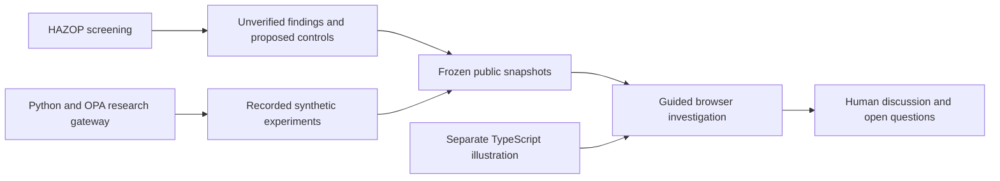

# Agentic Process Safety (APS)

**You need 24 bearings by Thursday. Can purchasing place one currently authorized order?** Start with a short, interactive hazard and operability (HAZOP) study of a request for 300 simulated spend units. Predict what might happen if the order goes out late, check the model, then record one proposed decision for your role.

[Open APS at the site root](https://safetymp.github.io/Agentic-Process-Safety/) · [Short study (`#/study`)](https://safetymp.github.io/Agentic-Process-Safety/#/study) · [Full workspace (`#/overview`)](https://safetymp.github.io/Agentic-Process-Safety/#/overview) · [User guide](docs/USER_GUIDE.md) · [Project vision](docs/VISION.md) · [Documentation](docs/README.md)

[](https://github.com/SafetyMP/Agentic-Process-Safety/actions/workflows/repository-checks.yml)
[](https://github.com/SafetyMP/Agentic-Process-Safety/actions/workflows/deploy-pages.yml)
[](LICENSE)

## Follow one purchase from handoff to decision

1. **Compare the handoffs.** Buyer-led ERP purchasing and delegated agent workflows can both automate steps and carry stale facts. Delegation lets a later worker act on evidence inherited from planning, sourcing or finance.
2. **Apply LATE at purchase.** Predict what could go stale before revealing the result. REF-008 is an unverified scenario in which using an expired supplier quotation could commit the buyer above the authorized price. The browser illustrates a related finance approval check with B and C evaluating the same agent request at selectable ages of 59, 60 and 61 logical seconds. Quote validity, stock and demand require their own evidence.
3. **Record one decision.** An executive decides whether to sponsor a shadow pilot and names a stop condition. For a comparison where C holds the order, a field manager chooses one fictional purchasing update and proposes a disposition with evidence, an owner and a deadline. A professor or researcher interprets the timing boundary and names a limit or field observation. Review the summary and revise the decision as needed.

Open the full workspace for all nine cases and richer audience exercises and exports. Use the linked hazard, controls and evidence to inspect the source scenario and the separate frozen trial pair. [Case Lab](https://safetymp.github.io/Agentic-Process-Safety/#/simulator) · [Hazard study](https://safetymp.github.io/Agentic-Process-Safety/#/hazop?hazard=APS-f47191931b96a999a61c) · [Controls](https://safetymp.github.io/Agentic-Process-Safety/#/governance?control=CTL-EXPIRY) · [Evidence](https://safetymp.github.io/Agentic-Process-Safety/#/assurance?story=stale) · [Audience task cards](docs/AUDIENCE_WALKTHROUGHS.md)

The earlier full-workspace experience was deployed on **2026-11-14** through [PR #32](https://github.com/SafetyMP/Agentic-Process-Safety/pull/32), at commit [`3ddc4ae`](https://github.com/SafetyMP/Agentic-Process-Safety/commit/3ddc4ae9a0dc42c5af98fa7818121cf18a1b364f). Its [deployment workflow](https://github.com/SafetyMP/Agentic-Process-Safety/actions/runs/43645203614) and 233-check browser run passed. This is a dated implementation result; badges and later runs describe subsequent revisions.

## What the evidence means

| Material | What it supports | What it does not establish |
| --- | --- | --- |
| Illustrative browser comparison | How the fixed model's checks respond to the selected request | A live gateway decision, real purchase or complete business outcome |
| Frozen recorded experiments and replay | The retained synthetic trial's actual recorded calls and outcomes | That an edited browser request was executed in that trial |
| HAZOP findings and proposed controls | Questions, possible deviations and control mappings to investigate | Verified hazards, approved requirements or validated risk ratings |
| Human discussion | A recommendation, rationale, sources, uncertainty and dissent | Operational authorization or independent verification of the cited evidence |

All hazards remain unverified, requirements proposed and risk ratings unset in the published fixtures. No real purchase or payment is made. The app does not establish production safety, safety certification, or that HAZOP outperforms another review method. Conventional systems can implement the same lifecycle checks. See the [vision and research questions](docs/VISION.md), [methodology](docs/METHODOLOGY.md) and [threat model](docs/THREAT_MODEL.md).

## Run locally

For the browser app, use **Node.js 22.18+** and npm from the repository root. There is one root lockfile.

```sh
git clone https://github.com/SafetyMP/Agentic-Process-Safety.git
cd Agentic-Process-Safety
npm ci
npm run demo:dev
```

Open the local URL printed by Vite. To inspect the production build locally:

```sh
npm run demo:build
npm run demo:preview
```

The separate research implementation requires **Python 3.11+** and **OPA 1.x** on `PATH`:

```sh
python3 -m venv .venv
.venv/bin/pip install -r requirements.lock
npm ci
npm run demo
```

The browser app never calls this Python/OPA gateway. See [Phase 2 operations](docs/PHASE2_OPERATIONS.md) for setup and policy workflows, and [Phase 3 operations](docs/PHASE3_OPERATIONS.md) for experiments, offline dependencies and evidence inspection.

## Repository map



| Location | Responsibility |
| --- | --- |
| [`apps/aps-demo/`](apps/aps-demo/) | React/TypeScript guided workspace; [browser model](apps/aps-demo/src/domain/README.md) and [fixture provenance](apps/aps-demo/src/fixtures/README.md) |
| [`packages/engine/`](packages/engine/) · [`schemas/`](schemas/) · [`examples/`](examples/) | Deterministic HAZOP screening, review contracts and authored examples |
| [`packages/simulator/`](packages/simulator/) | Procurement orchestrator and simulated workers |
| [`packages/governance/`](packages/governance/) · [`policies/v1/`](policies/v1/) | Research gateway, OPA/Rego controls, experiments and assurance tooling |
| [`tests/`](tests/) · [`scripts/`](scripts/) | Regression tests, integrity checks and evidence verification |
| [`docs/`](docs/README.md) | Current guides, technical references and clearly classified historical records |

## Verify a change

```sh
node scripts/verify-repository-readiness.mjs
npm run demo:production:check
npm run demo:fixtures:check
npm run demo:lint
npm run demo:typecheck
npm run demo:test
npm run demo:build
npm run demo:static:check
```

Real-browser verification uses `npm run demo:e2e` with the pinned Playwright browser. Follow the browser setup in [Contributing](CONTRIBUTING.md) and the [development reference](docs/DEVELOPMENT_REFERENCE.md). Root `npm test` invokes the research gateway and needs the Python/OPA setup. Fresh acceptance must bind the exact source, workflow, artifact and reviewed screenshots; historical receipts cannot qualify new source.

## Contribute and discuss

Start with [Contributing](CONTRIBUTING.md), [Support](SUPPORT.md), the [Code of conduct](CODE_OF_CONDUCT.md), and [Security reporting](SECURITY.md). Useful contributions improve causal explanations, evidence mappings, reproducibility, accessibility and the quality of open questions. The [vision](docs/VISION.md) distinguishes current capability from research still needed.

Coding agents should start with [AGENTS.md](AGENTS.md) for repository navigation and contribution constraints. Cite a specific revision using the [citation metadata](CITATION.cff); research results and interface revisions have different evidence boundaries.

Part of the [SafetyMP portfolio](https://github.com/SafetyMP). Project-owned material is offered under [Apache-2.0](LICENSE), with third-party terms preserved. The [open-source readiness record](docs/open-source-readiness.md) documents remaining ownership and governance questions; a license is not certification of industrial suitability.
