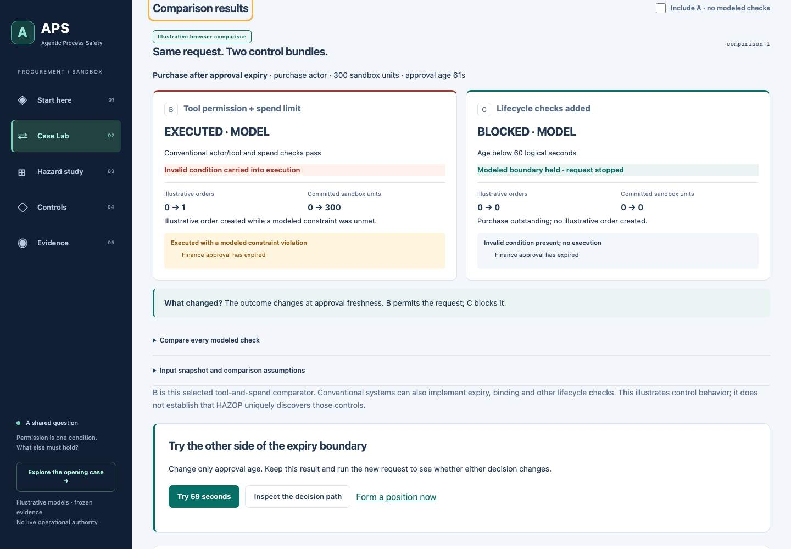
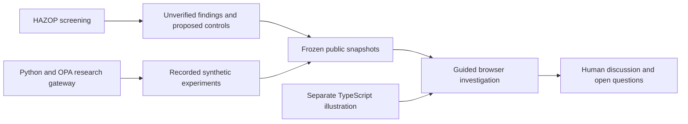

# Agentic Process Safety (APS)

**Finance approved the purchase yesterday. Can the buyer release the order today?** A buyer would want to know whether the approval still covers this supplier, amount and requisition, and whether the stock is still needed. Agentic Process Safety (APS) lets supply chain teams and researchers investigate that same decision when software agents carry the request from replenishment planning to order release.

[**Explore the live app**](https://safetymp.github.io/Agentic-Process-Safety/) · [Start the guided investigation](docs/USER_GUIDE.md) · [Project vision](docs/VISION.md) · [Documentation](docs/README.md)

[](https://github.com/SafetyMP/Agentic-Process-Safety/actions/workflows/repository-checks.yml)
[](https://github.com/SafetyMP/Agentic-Process-Safety/actions/workflows/deploy-pages.yml)
[](LICENSE)

## How a replenishment request reaches a purchase order

Before AI agents, a planner could review a material requirements planning (MRP) recommendation against stock on hand and open orders. A buyer could check the supplier and terms, then send a requisition for approval. Enterprise resource planning (ERP) systems already routed approvals and could convert an approved requisition into a purchase order under configured rules. Buyers handled exceptions such as a changed quote. [Oracle Purchasing guide to requisitions](https://docs.oracle.com/cd/A60725_05/html/comnls/us/po/reqov.htm) · [Oracle Release 11 procurement workflows](https://docs.oracle.com/cd/A60725_05/html/comnls/us/ponew/ponew11.htm)

| Purchasing decision | What an agent can contribute | What can go wrong at the handoff |
| --- | --- | --- |
| Do we need to buy? | An inventory agent can use a demand estimate to work out a replenishment need and pass it to sourcing. | An estimate for another requisition can travel with the request. A buyer tracing the quantity needs the underlying demand and stock records. |
| Which supplier and terms can we use? | A sourcing agent can select an eligible supplier and hand its result to finance. | A quote can change while the request is waiting. Even a current spending approval leaves the price to be checked. |
| May we place the order now? | A purchasing agent can invoke the order tool once it receives the finance decision. | An approval can expire before release. A retry after an uncertain response can also duplicate an order unless the prior outcome is checked. |

A buyer given a shortage to resolve might check inbound deliveries first and ask for a new quote only if the shortage remains. An AI agent with access to those tools could choose its next step from what it finds and bring the buyer an exception to decide. That discretion creates a practical question at each handoff. Which supplier, requisition and authority does this result belong to? APS isolates that question using fixed worker roles and simulated tool calls. The browser runs no live AI inference.

Risk review also predates agents. In a hazard and operability (HAZOP) study, a team works through a process and uses prompts such as “late” to ask what could go wrong. For purchasing, “late” might mean approval arrives after a supplier’s cutoff. APS applies that method to software handoffs and generates candidate findings for people to assess. A reviewer still has to establish whether the failure is plausible in their operation and what its consequences would be. [IEC guide to HAZOP studies](https://webstore.iec.ch/en/publication/24321) · [APS screening method](docs/METHODOLOGY.md)

## One case, two ways to use it

**For supply chain professionals.** In the opening case, the purchasing agent has permission and budget. Its request arrives 61 logical seconds after finance approval, one second past the model’s expiry boundary. The basic checks release the order. Adding an expiry check holds it, leaving the replenishment request open. In the worksheet, name who owns that exception, what the buyer should verify with planning and the supplier, and who can renew the spending authority before another attempt. [Walk through the approval case](docs/USER_GUIDE.md#follow-the-opening-case)

**For supply chain researchers.** Does checking approval again at release change which orders go through? Hold the request, spend and starting state fixed, then compare the two control bundles at 59 and 61 logical seconds. Record whether the order executes and whether approval was current. Both bundles evaluate the same agent request. A comparison with a buyer using an ERP requires a separate baseline with equivalent approval rules. The 30 recorded synthetic trials provide traces to inspect. Estimating effects on fill rate, buyer workload or time to resolve a hold would require operational observations. [Research exercise](docs/USER_GUIDE.md#design-a-supply-chain-study) · [Recorded experiment methods](docs/PHASE3_OPERATIONS.md)

## Try the experience

The [live app](https://safetymp.github.io/Agentic-Process-Safety/) needs no account, API key, paid inference, installation or backend.

1. Open the approval case and **Run comparison**. B checks tool permission and spend; C adds lifecycle conditions. Both receive the same request and starting state.
2. Follow the decision path, then choose **Try 59 seconds** and run again. The original comparison remains available. C now permits the request because the approval is current.
3. Choose **Form a position**. A recommendation opens a relevant evidence request, review question or eligible hypothetical recovery. Attach the modeled check or a related recorded event, explain the rationale, and state what would change your mind.

Five connected views support that investigation: **Start here → Case Lab**, with **Hazard study**, **Controls** and **Evidence** available as supporting inspections. The [user guide](docs/USER_GUIDE.md) covers all nine cases, saved discussions, exports and the distinction between a new request and a retained result.



The guided experience was deployed on **2026-11-14** through [PR #32](https://github.com/SafetyMP/Agentic-Process-Safety/pull/32), at commit [`3ddc4ae`](https://github.com/SafetyMP/Agentic-Process-Safety/commit/3ddc4ae9a0dc42c5af98fa7818121cf18a1b364f). Its [deployment workflow](https://github.com/SafetyMP/Agentic-Process-Safety/actions/runs/43645203614) and 233-check browser run passed. This is a dated implementation result; badges and later runs describe subsequent revisions.

## What the evidence means

| Material | What it supports | What it does not establish |
| --- | --- | --- |
| Illustrative browser comparison | How the fixed model's checks respond to the selected request | A live gateway decision, real purchase or complete business outcome |
| Frozen recorded experiments and replay | The retained synthetic trial's actual recorded calls and outcomes | That an edited browser request was executed in that trial |
| HAZOP findings and proposed controls | Questions, possible deviations and control mappings to investigate | Verified hazards, approved requirements or validated risk ratings |
| Human discussion | A recommendation, rationale, sources, uncertainty and dissent | Operational authorization or independent verification of the cited evidence |

All hazards remain unverified, requirements proposed and risk ratings unset in the published fixtures. No real purchase or payment is made. The app does not establish production safety, safety certification, or that HAZOP outperforms another review method. Conventional systems can implement the same lifecycle checks. See the [vision and research questions](docs/VISION.md), [methodology](docs/METHODOLOGY.md) and [threat model](docs/THREAT_MODEL.md).

## Run locally

For the browser app, use **Node.js 22.18+** and npm from the repository root. There is one root lockfile.

```sh
git clone https://github.com/SafetyMP/Agentic-Process-Safety.git
cd Agentic-Process-Safety
npm ci
npm run demo:dev
```

Open the local URL printed by Vite. To inspect the production build locally:

```sh
npm run demo:build
npm run demo:preview
```

The separate research implementation requires **Python 3.11+** and **OPA 1.x** on `PATH`:

```sh
python3 -m venv .venv
.venv/bin/pip install -r requirements.lock
npm ci
npm run demo
```

The browser app never calls this Python/OPA gateway. See [Phase 2 operations](docs/PHASE2_OPERATIONS.md) for setup and policy workflows, and [Phase 3 operations](docs/PHASE3_OPERATIONS.md) for experiments, offline dependencies and evidence inspection.

## Repository map



| Location | Responsibility |
| --- | --- |
| [`apps/aps-demo/`](apps/aps-demo/) | React/TypeScript guided workspace; [browser model](apps/aps-demo/src/domain/README.md) and [fixture provenance](apps/aps-demo/src/fixtures/README.md) |
| [`packages/engine/`](packages/engine/) · [`schemas/`](schemas/) · [`examples/`](examples/) | Deterministic HAZOP screening, review contracts and authored examples |
| [`packages/simulator/`](packages/simulator/) | Procurement orchestrator and simulated workers |
| [`packages/governance/`](packages/governance/) · [`policies/v1/`](policies/v1/) | Research gateway, OPA/Rego controls, experiments and assurance tooling |
| [`tests/`](tests/) · [`scripts/`](scripts/) | Regression tests, integrity checks and evidence verification |
| [`docs/`](docs/README.md) | Current guides, technical references and clearly classified historical records |

## Verify a change

```sh
node scripts/verify-repository-readiness.mjs
npm run demo:production:check
npm run demo:fixtures:check
npm run demo:lint
npm run demo:typecheck
npm run demo:test
npm run demo:build
npm run demo:static:check
```

Real-browser verification uses `npm run demo:e2e` with the pinned Playwright browser. Follow the browser setup in [Contributing](CONTRIBUTING.md) and the [development reference](docs/DEVELOPMENT_REFERENCE.md). Root `npm test` invokes the research gateway and needs the Python/OPA setup. Fresh acceptance must bind the exact source, workflow, artifact and reviewed screenshots; historical receipts cannot qualify new source.

## Contribute and discuss

Start with [Contributing](CONTRIBUTING.md), [Support](SUPPORT.md), the [Code of conduct](CODE_OF_CONDUCT.md), and [Security reporting](SECURITY.md). Useful contributions improve causal explanations, evidence mappings, reproducibility, accessibility and the quality of open questions. The [vision](docs/VISION.md) distinguishes current capability from research still needed.

Coding agents should start with [AGENTS.md](AGENTS.md) for repository navigation and contribution constraints. Cite a specific revision using the [citation metadata](CITATION.cff); research results and interface revisions have different evidence boundaries.

Part of the [SafetyMP portfolio](https://github.com/SafetyMP). Project-owned material is offered under [Apache-2.0](LICENSE), with third-party terms preserved. The [open-source readiness record](docs/open-source-readiness.md) documents remaining ownership and governance questions; a license is not certification of industrial suitability.
