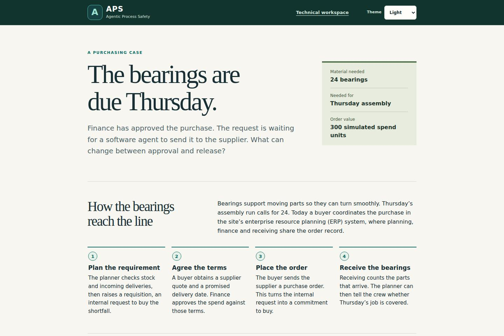

# Agentic Process Safety (APS)

Thursday’s assembly needs **24 bearings**. Finance has approved purchase request **REQ-218**, and a software agent is waiting to send it to the supplier. While it waits, the supplier’s quote can expire, finance approval can lapse, or another shipment can cover the job. What should the buyer do when the request reaches purchasing?

[Explore the interactive bearings case](https://safetymp.github.io/Agentic-Process-Safety/#/study)

[](https://safetymp.github.io/Agentic-Process-Safety/#/study)

## Follow the order

1. **Start on the assembly line.** Follow the buyer, planner and receiving team from requisition to Thursday’s run. Try an empty bin and a full set of bearings. An order acknowledgment tells the buyer what the supplier accepted. The receiving and allocation records tell the crew what it can use.
2. **Examine the delay.** In the hazard and operability study (HAZOP), the guide word **LATE** prompts a question about supplier quote Q-82. Then try the APS finance check on the same order. Approval is current at 59 seconds and expires at 60. The buyer still verifies the supplier’s terms and Thursday’s stock.
3. **Decide what is worth funding.** Compare buyer-led purchasing, an approval check in the existing system and a four-week shadow pilot. The worked example frees six buyer minutes after a release and three after a hold. At the assumed volume and costs, including setup, the first year breaks even at 4.5 minutes per request. What do the site’s time records, open holds and on-time receipts tell you about those assumptions? [Financial worksheet and sources](docs/BUSINESS_CASE.md) · [Discussion prompts](docs/AUDIENCE_WALKTHROUGHS.md)

## Open REQ-218 in the IT workspace

Follow the selected request through the policy check and illustrative receipt. The table in the workspace compares your selection with a recorded synthetic trial. These two links reopen directly at contrasting points in the case.

| Shared case | Supplier quote Q-82 | Stock for Thursday | Recorded trial |
| --- | --- | --- | --- |
| [Release at 59 seconds](https://safetymp.github.io/Agentic-Process-Safety/#/overview?age=59&quote=14%3A05&stock=0&trial=14) | Expired at Tuesday’s 14:05 attempt | 0 of 24 | B · 14 allowed the delayed purchase |
| [Hold at 61 seconds](https://safetymp.github.io/Agentic-Process-Safety/#/overview?age=61&quote=13%3A55&stock=24&trial=15) | Current at Tuesday’s 13:55 attempt | 24 of 24 | C · 15 denied the delayed purchase |

To share your own example, choose the timing, quote and stock in the case, open **Technical workspace**, select a trial and choose **Copy comparison link**. The link carries all four selections. The workspace also links the request schema, Rego policy and gateway tests. [User guide](docs/USER_GUIDE.md) · [Gateway architecture](docs/GOVERNANCE_ARCHITECTURE.md)

## Run locally

For the browser app, use **Node.js 22.18+** and npm from the repository root. There is one root lockfile.

```sh
git clone https://github.com/SafetyMP/Agentic-Process-Safety.git
cd Agentic-Process-Safety
npm ci
npm run demo:dev
```

Open the local URL printed by Vite. To inspect the production build locally:

```sh
npm run demo:build
npm run demo:preview
```

The separate research implementation requires **Python 3.11+** and **OPA 1.x** on `PATH`:

```sh
python3 -m venv .venv
.venv/bin/pip install -r requirements.lock
npm ci
npm run demo
```

The browser app never calls this Python/OPA gateway. See [Phase 2 operations](docs/PHASE2_OPERATIONS.md) for setup and policy workflows, and [Phase 3 operations](docs/PHASE3_OPERATIONS.md) for experiments, offline dependencies and evidence inspection.

## Repository map

| Location | Responsibility |
| --- | --- |
| [`apps/aps-demo/`](apps/aps-demo/) | React/TypeScript case and IT guide; [browser model](apps/aps-demo/src/domain/README.md) and [fixture provenance](apps/aps-demo/src/fixtures/README.md) |
| [`packages/engine/`](packages/engine/) · [`schemas/`](schemas/) · [`examples/`](examples/) | Deterministic HAZOP screening, review contracts and authored examples |
| [`packages/simulator/`](packages/simulator/) | Procurement orchestrator and simulated workers |
| [`packages/governance/`](packages/governance/) · [`policies/v1/`](policies/v1/) | Research gateway, OPA/Rego controls, experiments and assurance tooling |
| [`tests/`](tests/) · [`scripts/`](scripts/) | Regression tests, integrity checks and evidence verification |
| [`docs/`](docs/README.md) | Current guides, technical references and clearly classified historical records |

## Verify a change

[](https://github.com/SafetyMP/Agentic-Process-Safety/actions/workflows/repository-checks.yml)
[](https://github.com/SafetyMP/Agentic-Process-Safety/actions/workflows/deploy-pages.yml)
[](LICENSE)

```sh
node scripts/verify-repository-readiness.mjs
npm run demo:production:check
npm run demo:fixtures:check
npm run demo:lint
npm run demo:typecheck
npm run demo:test
npm run demo:build
npm run demo:static:check
```

Real-browser verification uses `npm run demo:e2e` with the pinned Playwright browser. Follow the browser setup in [Contributing](CONTRIBUTING.md) and the [development reference](docs/DEVELOPMENT_REFERENCE.md). Root `npm test` invokes the research gateway and needs the Python/OPA setup. Fresh acceptance must bind the exact source, workflow, artifact and reviewed screenshots; historical receipts cannot qualify new source.

## Contribute and discuss

Start with [Contributing](CONTRIBUTING.md), [Support](SUPPORT.md), the [Code of conduct](CODE_OF_CONDUCT.md), and [Security reporting](SECURITY.md). Useful contributions improve causal explanations, evidence mappings, reproducibility, accessibility and the quality of open questions. The [vision](docs/VISION.md) distinguishes current capability from research still needed.

Coding agents should start with [AGENTS.md](AGENTS.md) for repository navigation and contribution constraints. Cite a specific revision using the [citation metadata](CITATION.cff); research results and interface revisions have different evidence boundaries.

Part of the [SafetyMP portfolio](https://github.com/SafetyMP). Project-owned material is offered under [Apache-2.0](LICENSE), with third-party terms preserved. The [open-source readiness record](docs/open-source-readiness.md) documents remaining ownership and governance questions; a license is not certification of industrial suitability.
