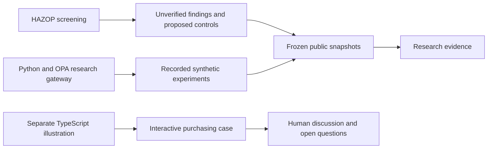

# Agentic Process Safety (APS)

**The bearings are due Thursday.** Assembly needs 24 bearings. Planning knows when the line needs them, purchasing knows what the supplier offered, and finance approved a specific purchase. By the time the request is ready to go to the supplier, that approval has expired. What happened between the planner’s request and the buyer’s release?

In today’s buyer-led process, the buyer can look up stock and open orders, check the supplier’s terms and confirm authority for the spend. Procurement records the order in the purchasing system. Receiving records what arrives. Those are different events. An approval does not put bearings on the shelf.

A purchasing agent inherits the request and approval from earlier steps. If it buys on expired authority, it can commit site funds to an order finance no longer authorizes. If it waits, someone must still find out whether stock or an inbound shipment will cover the assembly run. The case gives the requirement and the approval timing. Whether the line would run short, and how often buyers face this conflict today, are questions for site records.

[Explore the bearings case](https://safetymp.github.io/Agentic-Process-Safety/#/study) · [IT implementation workspace](https://safetymp.github.io/Agentic-Process-Safety/#/overview)

[](https://github.com/SafetyMP/Agentic-Process-Safety/actions/workflows/repository-checks.yml)
[](https://github.com/SafetyMP/Agentic-Process-Safety/actions/workflows/deploy-pages.yml)
[](LICENSE)

## What would you do?

A hazard and operability study (HAZOP) uses the guide word **LATE** to ask what could expire while the order waits. Try the same release at 59 and 60 seconds. The rule that rechecks finance approval holds the second order. The buyer still has to find out whether incoming stock will cover Thursday and, if necessary, seek fresh approval.

Would you keep buyer-led purchasing, add the check to the existing system, or run an agent alongside buyers for four weeks? The check could address the expired approval with a smaller change. An agent would need to justify its additional cost. Under the case assumptions, saving three buyer minutes per request yields **−$2,400** of first-year net capacity value. Saving six yields **+$2,400**. The investment turns on whether the site can free and use those hours while keeping material available on time. [Case assumptions and sources](docs/BUSINESS_CASE.md) · [Discussion prompts](docs/AUDIENCE_WALKTHROUGHS.md)

## Implementing the check

The IT workspace carries the selected REQ-218 attempt through the request, approval check and illustrative receipt. Compare its decision and adapter effect side by side with frozen trials 14 and 15. Open “Trace the HAZOP finding to the control” to follow the quotation-expiry finding from REF-008 to its proposed requirement and mapped control. [IT implementation workspace](https://safetymp.github.io/Agentic-Process-Safety/#/overview) · [User guide](docs/USER_GUIDE.md) · [Gateway architecture](docs/GOVERNANCE_ARCHITECTURE.md)

## Run locally

For the browser app, use **Node.js 22.18+** and npm from the repository root. There is one root lockfile.

```sh
git clone https://github.com/SafetyMP/Agentic-Process-Safety.git
cd Agentic-Process-Safety
npm ci
npm run demo:dev
```

Open the local URL printed by Vite. To inspect the production build locally:

```sh
npm run demo:build
npm run demo:preview
```

The separate research implementation requires **Python 3.11+** and **OPA 1.x** on `PATH`:

```sh
python3 -m venv .venv
.venv/bin/pip install -r requirements.lock
npm ci
npm run demo
```

The browser app never calls this Python/OPA gateway. See [Phase 2 operations](docs/PHASE2_OPERATIONS.md) for setup and policy workflows, and [Phase 3 operations](docs/PHASE3_OPERATIONS.md) for experiments, offline dependencies and evidence inspection.

## Repository map



| Location | Responsibility |
| --- | --- |
| [`apps/aps-demo/`](apps/aps-demo/) | React/TypeScript case and IT guide; [browser model](apps/aps-demo/src/domain/README.md) and [fixture provenance](apps/aps-demo/src/fixtures/README.md) |
| [`packages/engine/`](packages/engine/) · [`schemas/`](schemas/) · [`examples/`](examples/) | Deterministic HAZOP screening, review contracts and authored examples |
| [`packages/simulator/`](packages/simulator/) | Procurement orchestrator and simulated workers |
| [`packages/governance/`](packages/governance/) · [`policies/v1/`](policies/v1/) | Research gateway, OPA/Rego controls, experiments and assurance tooling |
| [`tests/`](tests/) · [`scripts/`](scripts/) | Regression tests, integrity checks and evidence verification |
| [`docs/`](docs/README.md) | Current guides, technical references and clearly classified historical records |

## Verify a change

```sh
node scripts/verify-repository-readiness.mjs
npm run demo:production:check
npm run demo:fixtures:check
npm run demo:lint
npm run demo:typecheck
npm run demo:test
npm run demo:build
npm run demo:static:check
```

Real-browser verification uses `npm run demo:e2e` with the pinned Playwright browser. Follow the browser setup in [Contributing](CONTRIBUTING.md) and the [development reference](docs/DEVELOPMENT_REFERENCE.md). Root `npm test` invokes the research gateway and needs the Python/OPA setup. Fresh acceptance must bind the exact source, workflow, artifact and reviewed screenshots; historical receipts cannot qualify new source.

## Contribute and discuss

Start with [Contributing](CONTRIBUTING.md), [Support](SUPPORT.md), the [Code of conduct](CODE_OF_CONDUCT.md), and [Security reporting](SECURITY.md). Useful contributions improve causal explanations, evidence mappings, reproducibility, accessibility and the quality of open questions. The [vision](docs/VISION.md) distinguishes current capability from research still needed.

Coding agents should start with [AGENTS.md](AGENTS.md) for repository navigation and contribution constraints. Cite a specific revision using the [citation metadata](CITATION.cff); research results and interface revisions have different evidence boundaries.

Part of the [SafetyMP portfolio](https://github.com/SafetyMP). Project-owned material is offered under [Apache-2.0](LICENSE), with third-party terms preserved. The [open-source readiness record](docs/open-source-readiness.md) documents remaining ownership and governance questions; a license is not certification of industrial suitability.
