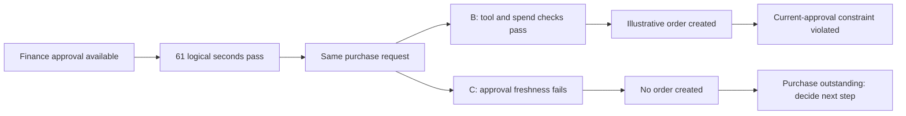

# APS experience redesign plan

Prepared 2026-11-14. Status: proposed design, grounded in the current local app and frozen evidence. No application code, policy, research fixture, approval state or deployment is changed by this plan.

## Product decision

Build APS around a question visitors can investigate: **“The agent has permission. Is this particular action still authorized?”**

The opening case is **A purchase arrives after its finance approval expires**. Users predict the outcome, compare two explicit control bundles against the same request, locate the point where behavior diverges, change one condition, and explain what protection and uncertainty remain. The app’s hazard study, control inspector and evidence views support that investigation.

Primary audience: engineers and technical decision-makers discussing consequential agent workflows. A facilitated workshop adds procurement, finance and assurance perspectives. The opening experience should remain understandable without knowing HAZOP, OPA or the repository.

Design hypothesis: a concrete counterfactual with visible effects will help visitors explain the distinction between tool permission, valid authorization and evidence of safety more reliably than the present module-first walkthrough. A visitor who can repeat “C blocked it” but cannot identify the expired condition or remaining uncertainty has not achieved the intended learning outcome.

## The opening case and its evidence

Use an illustrative purchase of **300 sandbox units**, a permitted purchase actor, matching task/context, an unused purchase identifier, and an existing finance approval. Set approval age to **61 logical seconds**, against the current browser rule requiring age **below 60**. All other modeled conditions pass. The 300-unit amount is a new teaching input, not a recovered historical trial amount.

Default comparison:

| Lane | User-facing label | Behavior at age 61 |
| --- | --- | --- |
| B | Tool permission + spend limit | Executes the illustrative purchase; fails the independently displayed current-approval constraint |
| C | Tool permission + spend limit + lifecycle checks | Rejects the expired approval; creates no illustrative order |

Explain the complete modeled check set on demand. Preserve A/B/C identifiers for research traceability. Describe B as **this selected comparator**, not as every conventional authorization system. Expiry, binding and idempotency are established engineering mechanisms; the comparison illustrates their contribution, not proof that HAZOP uniquely discovers them or outperforms other design methods.

The frozen `000-stale_approval` trials are especially suitable evidence: A/B/C sequences **13/14/15** share case digest `8a8d200d345484fceed615f992e677cad0d97e3b62290d6c9a3f8146287b4808`. Finance executes at logical time 1000000; purchase is attempted at 1000061. B executes with `expired_finance_approval`; C denies with that same violation and no execution. These are recorded observations of simulated adapters. The exported fixtures do not contain full request envelopes or order/spend snapshots, so they cannot support invented historical amounts or state deltas.

The evidence connection is **same fault family and control**, not identity between a newly edited browser request and the historical experiment. The broader REF-008 quotation-validity hazard is only partially addressed by authorization expiry. A fresh approval cannot establish that a price, forecast or stock record is true.

Sources: [browser rules](../apps/aps-demo/src/domain/simulation.ts), [recorded trials](../apps/aps-demo/src/fixtures/experiment.json), [purchase pilot boundary](pilot-readiness/pilot-charter.md), [gateway architecture](GOVERNANCE_ARCHITECTURE.md), [traceability matrix](TRACEABILITY_MATRIX.md).

## The first five minutes

Suggested duration is a design target, not a measured completion time. Exploration and skipping are always available.

| Moment | What the visitor sees and does | What APS reveals |
| --- | --- | --- |
| 1. Understand | “Finance approved this purchase. It reached execution 61 seconds later.” Inspect actor, amount, approval age and expiry rule. | The objective is one currently authorized purchase. No hazard IDs or research totals lead the page. |
| 2. Predict | Choose “both execute”, “only B executes”, “only C executes”, “neither executes” or “unsure”; optionally explain. “Show comparison” works without a prediction. | The prediction is retained as a discussion note, not scored as competence. |
| 3. Compare | Run both lanes together. Inspect identical input and aligned rule rows. | Both pass tool/spend checks. Only C checks freshness; it rejects at the expiry boundary. |
| 4. Follow effects | Select the divergence on the path. | B creates one illustrative order and adds 300 units of illustrative spend; C leaves both unchanged. C also leaves the business request unfulfilled. |
| 5. Change one fact | Set age to 59, then 60; compare new runs with the original. | At 59 both execute; at 60 C denies. The exact boundary matters. Previous outcomes stay visible. |
| 6. Reason | Open “What should happen next?” Choose a response and record evidence, uncertainty or disagreement. | Blocking an invalid action creates follow-up work. Passing all modeled checks does not settle quotation validity. |
| 7. Check support | Open related evidence and the LATE deviation. | See what the historical trial tested, why this control is proposed, and what remains outside its coverage. |

The default journey begins with the stale case. Follow-up examples include normal authorized purchase, where B and C both succeed, and unauthorized supplier purchase, where B and C both reject. Equal outcomes prevent a simplistic “C always wins” narrative.

## Case Lab layout and comparison behavior

Make the existing `/simulator` route the **Case Lab**, the only request runner. Desktop layout:

```text
Case: Purchase after approval expiry             Illustrative model
Objective: execute one currently authorized purchase
Shared request: purchase actor | 300 units | approval age 61s | limit <60s
Prediction [optional]                             [Run comparison]

Tool permission + spend (B)        Lifecycle checks added (C)
same request revision             same request revision
tool permission: passes           tool permission: passes
spend limit: passes               spend limit: passes
freshness: not checked            freshness: fails at 61 seconds
EXECUTED                          BLOCKED
orders 0 → 1; spend 0 → 300        orders 0 → 0; spend 0 → 0
current-approval constraint fails  no order; purchase still outstanding

[Shared path and synchronized branch point]
[Change approval age] [Compare with previous run]
[Discuss next action] [Inspect hazard] [Inspect control] [Related evidence]
```

The request is above the lanes so comparison inputs cannot silently diverge. Run performs one logical evaluation of both bundles; playback only explains an already computed result. Visitors can jump directly to the first differing check. “Not included”, “passed”, “failed” and “not evaluated after an earlier decision” are distinct states. A tooltip cannot be the only way to read a result.

Keep B and C pinned. Offer A (“No modeled checks”) as an optional third lane after the first result. On narrower screens, use a compact two-column outcome summary followed by aligned stacked check rows; preserve simultaneous access to both outcomes. Never require horizontal page scrolling or switching mutually exclusive tabs to compare them.

Every input edit creates a draft. Completed results keep their input snapshot. Show “Inputs changed — run again” until evaluated; never relabel old results with new values. Keep the original guided comparison and the immediately preceding comparison visible as comparison choices. Retain all completed runs for the current session, including their immutable inputs and starting states; runs referenced by predictions, worksheets or child branches cannot be silently discarded. Export and optional browser-local saving include this reference closure. Selected historical evidence remains independent of these browser runs.

Ordinary reruns are independent counterfactuals from the case’s shared starting state: zero orders and zero committed spend for the opening case. Evaluating again never accumulates another effect. “Reset inputs” restores the preset draft without deleting history or notes; “Clear session” explicitly removes local session records. Saved-storage failures are visible and leave in-memory records available for export.

## Visible failure path

Use a causal path at the center of the case, with the full procurement topology available as context. Initial focus: **finance approval → delay → purchase request → checks → illustrative effect → outstanding work**. The orchestrator and earlier workers are collapsed as declared prerequisites, not animated as newly executed agents.



Select any node to reveal its relevant input, check, effect and source relationship. Highlight the first divergent condition and resulting branch; mute unrelated links. Use labels, line styles and icons as well as color. A keyboard-accessible ordered text path carries the same information.

Separate four kinds of claims visually: declared prerequisite, modeled event, recorded event, possible downstream consequence. An order created after expiry is a modeled effect; financial loss or delivery failure is only a possible consequence unless separately modeled and supported. Do not draw hypothetical loss as an observed event. Do not equate a completed timeline with a successful business outcome.

The new browser model may project order count and spend explicitly. These are defined illustrative variables, not real procurement or reconstructed recorded state. For recorded replay, show only exported call/effect flags and violation annotations. Missing state snapshots are “not recorded in this view”.

## Meaningful choices

Release the controls in stages so the first encounter remains legible.

| Choice | Initial behavior | What it teaches |
| --- | --- | --- |
| Approval age | Numeric input and slider 0–120 logical seconds; shortcuts 59/60/61; fixed 60-second threshold | Timing changes authorization without changing actor or amount |
| Fresh-approval branch | After denial, “Explore a new request with a fresh matching approval” creates a child scenario with explicit assumptions and age 0 | Remediation creates a new attempt; it does not rewrite the denied attempt or issue real approval |
| Case selection | Normal, unauthorized, stale in the first guided path; retain other existing stories in the library | Additional controls sometimes change outcomes and sometimes do not |
| Purchase amount | Later expose integer sandbox amounts, especially 500/501 and 1000/1001 | Review and unconditional denial are different outcomes |
| Context binding | Later expose same-task versus another-task context | Valid actor identity alone does not validate context |
| Custom control bundle | Later allow expiry/context controls to be disabled in a separate “Custom” lane | A missing mechanism can explain a changed outcome without changing immutable B/C definitions |

Custom rules never overwrite the canonical C lane or inherit its recorded evidence claim. Keep the modeled validity constraint fixed when removing an enforcement check, so disabling expiry cannot redefine an expired execution as acceptable. Any future editable validity threshold must be identified as a changed assumption and reviewed separately from disabling enforcement.

Remove seed from primary controls. Retain deterministic preset IDs/model versions in technical details. Combine the current scenario and fault selectors into one effective case definition; all views must describe the actual request being evaluated. Complex multiple-fault experiments are deferred.

## Human reasoning and discussion

Add a **Discussion worksheet** accessible beside the comparison and from every supporting route. It is an in-session learning artifact. It never changes authoritative hazard review states, activates policies, or grants execution authority.

For the stale case, show two positions: procurement wants timely completion; finance requires a valid approval. Ask “What should happen next, and what evidence would change your answer?” Suggested responses:

- Hold the purchase and obtain a new matching approval.
- Request additional information about the quotation or demand before proposing a new attempt.
- Propose a different expiry policy for later review.
- Leave the decision unresolved and record the disagreement.

Each saved position includes the referenced run/input revision, recommendation, rationale, evidence links, assumptions, remaining question and optional dissent. Allow incomplete drafts and “insufficient evidence”; require rationale before labeling a position ready for discussion. Avoid numerical confidence scores and automatic risk acceptance.

A fresh-approval branch is available after C denies the stale request, regardless of whether a recommendation was saved. It names C as its parent lane and copies C’s no-effect state (zero orders, zero committed spend). Both child comparison lanes start from that same state; neither continues B’s already executed parent branch. Supply a new illustrative request identity/unused nonce and assume a newly issued exact approval, age 0, with task/context still valid. Do not rewind or modify the original event. Display these assumptions and “Hypothetical recovery; not demonstrated by the recorded trial”. Re-evaluate every modeled check before creating any child effect. The UI does not impersonate a finance approver or claim the backend can reissue authorization in that state.

In the later >500-unit example, separate “propose proceeding if exact authorization is supplied” from “explore a synthetic exact grant”. A note alone never changes a denied or pending run. Hard denials still block the modeled effect. Unresolved objective conflict remains unresolved unless the user changes explicit modeled conditions in a new hypothetical run; a button cannot claim to solve objective arbitration.

At the end, generate an on-demand local discussion brief: original prediction, compared inputs, changed condition, outcomes, selected rationale, dissent, evidence relationship and residual gap. Export JSON plus readable text/Markdown. No cloud collaboration, automatic transmission or user identity verification is implied. Keep notes in memory by default; explicitly offer browser-local saving and deletion. Never put free-text notes into shareable URLs. Config-only links reconstruct presets and labeled browser inputs, not executed results or approvals.

## How the full app supports the case

Retain the existing five route identifiers to preserve links; change visible names, order and responsibilities. A compact case header persists across routes: case name, selected run, changed-input indicator, source category and “Return to comparison”. Navigating to supporting material does not reset a run or worksheet.

| Navigation | Existing route | Redesign responsibility |
| --- | --- | --- |
| Start here | `/overview` | State the problem in one sentence; preview the stale case; offer “Explore this case” and “Browse cases”. Explain intent → deviation → control → evidence below. Move project counts and full topology into secondary sections. |
| Case Lab | `/simulator` | Own paired evaluation, editable inputs, retained comparisons, causal path and worksheet. Replace decorative three-tick progression with meaningful stages. |
| Hazard study | `/hazop` | Start with the selected case’s intent/deviation/consequence and assumptions. Offer all 96 screening entries as a matrix of nodes × deviations; indicate authored mapping, generic prompt, evidence link and explicit gap without inventing criticality. |
| Controls | `/governance` | Explain what each selected control checks, where authority comes from, what it cannot establish, and its tests. Remove duplicate request runner. Display matched inputs and link back to the Case Lab for edits. |
| Evidence | `/assurance` | Answer “What happened?”, “What supports this?”, and “What remains unknown?” Start with the selected case’s relevant recorded calls, then allow wider experiment inspection. |

Use human-readable case titles, for example “Purchase proceeds after finance approval expires”. Hazard row labels faithfully summarize their actual source finding; retain original wording and stable IDs in details. Do not rename the broader quotation hazard as though it were only approval expiry. Every hazard-to-case link must resolve through an explicit relationship; otherwise show “No interactive case for this finding”. Do not send unrelated findings to the unauthorized-tool story.

Existing `story`, `hazard`, `control` and `trial` deep links continue to resolve. A legacy governance story link selects the matching case and displays its controls with a clear “Run comparison” action. A legacy selected trial remains selected in Evidence even if its fault differs from the active browser case; show the mismatch rather than silently substituting a trial.

The case library retains all nine existing stories, with explicit tags for interactive-model coverage, related recorded evidence and open semantic gaps. The first three receive the complete guided experience. For remaining stories, provide accurate rule comparison and clearly identify effects that are not modeled; do not extrapolate the purchase order projection to recursive delegation or other different effects. Empty mappings and unsupported extensions remain visible.

## Evidence and visual system

Use two explicit Evidence views: **This browser comparison** and **Recorded experiments**. Recorded replay is an inspection mode with edits disabled. “Try a variation” forks into the browser model and shows the changed provenance. Each surface carries its own source badge; remove the global strip listing three categories without identifying which one applies.

Recorded stale comparison aligns B #14 and C #15 by semantic action/stage. Show `expired_finance_approval` in both, with executed versus not executed distinguished. Explain that the invalid input existed in both lanes; prevention means no resulting execution. Expose source selection, trial identity, hashes and selectors through expandable technical details. A case-family relationship is not an exact-input match. Context’s recorded `message_poisoning` divergence occurs at demand, unlike the current purchase-oriented browser illustration, and must be labeled accordingly.

Replace the single mixed-unit chart with separate labeled summaries for unsafe mutations/attack calls and completed trials/planned trials, retaining numerators, denominators and missingness. Add persistent legends or direct labels. Tables remain the complete alternative. Verify chart bars actually render in supported browsers; a populated table does not count as chart success.

Keep the established navy/teal visual language and theme support. Make the shared request and comparison the dominant content. Use amber for pending review and distinct neutral treatments for unknown and unmodeled states. “Allowed” means modeled authorization passed, not “safe”; “blocked” means no effect in this model, not successful completion. Avoid green/red verdicts about the project as a whole.

At 1440px, place request and paired outcomes within the first screen of Case Lab, with the path immediately below. At 768px and 375px, retain the compact paired summary and readable stacked details. Keyboard navigation must reach path stages, lane differences, sliders/numeric alternatives, details and worksheet. Provide visible focus, semantic headings, polite single-result announcements, chart tables, non-color encodings and reduced-motion/static playback. Visual testing covers both themes; accessibility conformance requires its own assessment and is not inferred from these features.

## Implementation shape

Preserve React/TypeScript/Vite, React Flow, existing frozen fixtures and the separate Python/OPA research runtime. No new backend, paid inference, telemetry or library is necessary for this scope.

| Area | Proposed responsibility |
| --- | --- |
| `domain/cases.ts` (new) | Versioned case presets; declared assumptions; editable fields; available effect projection; explicit hazard/control/evidence relationships |
| `domain/comparison.ts` (new) | Pure evaluation of one immutable input against selected bundles, ordered rule differences, and illustrative effect projection |
| `domain/session.ts` (new) | Draft input, completed comparisons, prior-run selection, fork lineage, selected step and discussion drafts |
| `domain/simulation.ts` | Reuse/refactor ordered rule logic; retire story-name-based unsafe/completion inference in favor of explicit conditions and effects |
| `data.ts` / selectors | Separate illustrative selectors from frozen trial selectors; validate case-family mappings and declared partial coverage |
| Route components | Compose shared comparison/path/evidence/worksheet components; route changes select views without mutating historical inputs |
| `App.tsx` | Own shared session and navigation; replace the hard-coded unauthorized walkthrough with case-specific milestones |

Core records: `CaseDefinition`, `InputRevision`, `ComparisonRun`, `LaneResult`, `EvidenceRelationship`, `DiscussionDraft`. A run binds case/model version, identical request snapshot for each lane, bundle definitions, checks, effect projections and modeled-constraint evaluation. A child run identifies its parent and changed fields. Discussion references a run; changing the input does not silently attach an old recommendation to a new result.

Keep three things separate: the enforcement decision, the modeled constraint status of an executed effect, and the business outcome. For example, a denied purchase has no order and an outstanding request; it is not an executed unsafe action. Do not use `story !== normal` to classify every outcome. Reviewer recommendation is a fourth independent record.

Define input validation before rendering controls. Browser age is bounded nonnegative logical time; amounts are finite positive integers in sandbox units. Reject malformed values with inline errors rather than silently evaluating a different request. Validate URL-restored configuration against the versioned schema. Wall-clock playback never changes authorization age unless the visitor explicitly edits logical time.

## Delivery order and acceptance

Each stage produces a reviewable increment. The complete first delivery includes stages 1–4; stage 1 alone is not the full redesign. Publication and participant recruitment are separate future actions.

| Stage | Deliverable | Exit condition |
| --- | --- | --- |
| 1. Core case | Stale/normal/unauthorized paired evaluation; immutable inputs; explicit rule/effect results; draft-versus-run separation | Boundary matrix passes; B/C receive identical input; frozen fixtures unchanged; existing cases remain accessible |
| 2. Visible explanation | Case Lab screen, synchronized path, previous comparison, 59/60/61 controls, prediction and residual-gap copy | Visitor can locate divergence and inspect both effects without changing screens; keyboard/mobile/theme review passes |
| 3. Full-app continuity | Overview, Hazard study, Controls and Evidence redesigned around case context; semantic links and recorded replay separation | All existing deep links resolve; navigation preserves comparison; unsupported mapping is explicit; charts visibly render |
| 4. Human reasoning | Worksheet, fresh-approval branch, dissent and local brief export; independent design/code review | Notes cannot authorize effects; forks retain originals; export identifies provenance and remaining uncertainty; first journey complete |
| 5. Extend after review | Context/amount controls, custom lane, richer secondary case effects | Each addition explains a distinct mechanism and has matching semantic tests; no blanket relabeling of evidence |

Meaningful checks for implementation:

- Age 59: B/C allow with one illustrative order; age 60 and 61: B allows/C denies. No other input differs. Scope and spend failures still deny in both lanes.
- Normal and unauthorized cases demonstrate equal outcomes. Repeated evaluation of identical input/model yields identical semantic results. No lane mutates another lane’s state.
- Amount 500/501 and 1000/1001 distinguish allow/review/deny once those inputs ship. Hard denials cannot be overridden by a discussion recommendation or synthetic human grant.
- Editing age, changing a case, navigating, replaying, or inspecting another trial never changes an earlier run, recorded fixture, hazard status or rationale binding.
- Removing expiry in Custom changes enforcement while the invalid-approval condition remains detectable. Request validity and business completion do not derive from scenario names.
- Fresh-approval exploration creates a new illustrative branch, preserves the denied original, and states its assumptions. Recorded replay never gains editable model fields.
- Ordinary reruns restart from the shared baseline and do not accumulate effects. A fresh-approval child starts both lanes from the named C no-effect state, uses a new request identity, and cannot continue B’s already executed order as a second purchase.
- After the 61 → 59 → 60 exploration and further runs, original predictions, rationale, selected run and child lineage remain inspectable and exportable without manual pinning. Resetting inputs preserves them; clearing the session is a separate explicit action.
- Browser comparisons and recorded results remain separate after export and reload. Config links carry no free-text discussion, authority or fabricated execution proof.
- No missing mapping defaults to an unrelated story. One effective case drives objective, request, control and evidence relationship, including legacy fault injection paths.
- Exercise the complete journey in a real supported browser at 1440, 768 and 375px, both themes; confirm meaningful graph/chart output visually, keyboard operation, reduced motion, no horizontal page overflow and no unexpected outbound requests.

Run the existing relevant frontend lint/type/unit/build/static/e2e and fixture-integrity checks after implementation, adapted to the intended new interaction contracts. Retain original backend/policy expectations. Do not refresh frozen fixtures, alter protected-source pins or weaken repository checks to accommodate a presentation change; investigate any existing drift separately. Obtain an independent review focused on misleading causal/evidence claims as well as code correctness. Local verification, deployed verification and human evaluation must be reported separately.

## Learning evaluation proposed for later execution

After a working prototype, propose a small moderated formative review with engineers plus procurement/assurance perspectives. Recruitment and sessions have not been initiated. Use consistent tasks, collect individual observations and preserve misunderstandings; a small sample is design feedback, not proof of method effectiveness.

Ask participants to explain: why permission did not suffice; which condition changed the outcome; what 59 versus 60 means; what blocking leaves unresolved; and why a recorded trial does not validate their edited scenario or actual quotation. Then give an unpracticed context-binding case to check transfer rather than recollection. Ask for a next-action recommendation and one missing piece of evidence.

Record unaided/assisted completion, explanation accuracy, evidence-category confusion, rationale quality and time spent. Revise if participants describe C as universally safe, treat notes as approval, cannot find why lanes differ, or infer a real quotation was validated. Any formal old/new benefit claim needs a separately agreed comparison protocol; do not infer it from task completion or participant enthusiasm.

## Completion definition

The redesign succeeds as an implemented experience when a visitor can follow one case across all five views, compare identical inputs, explain a visible difference, make a consequential change, retain the prior result, contribute a reasoned position and inspect the evidence’s limits. Whether it improves expert decisions or hazard discovery remains a separate empirical question.

Design review: an independent read-only review verified the cited stale-trial facts and identified missing starting-state and history-retention contracts. This revision specifies shared baselines, the C-lane recovery fork and retention of referenced snapshots. This is design review, not implementation or usability validation.
