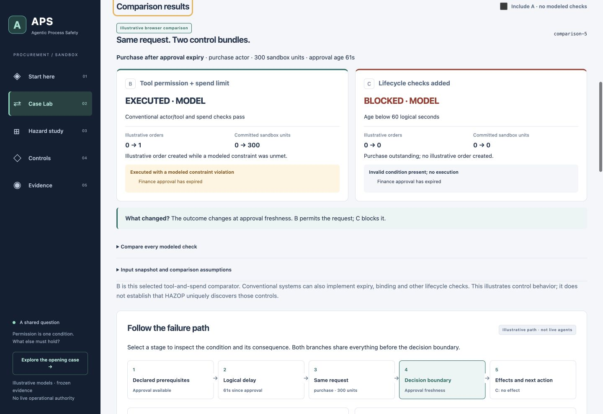

# APS experience redesign — implementation and verification

This historical implementation receipt predates the [release reconciliation](APS_REDESIGN_RELEASE.md). Its production-gate failure and unexecuted-browser-harness entries describe that earlier snapshot.

Date: 2026-11-14. Scope: stages 1–4 of [the accepted redesign plan](APS_EXPERIENCE_REDESIGN_PLAN.md), implemented in the existing React/TypeScript static app. Local implementation and verification are complete. Publication, source-bound Linux release acceptance and participant evaluation have not been performed for this redesign.

## Delivered increments

| Increment | Delivered behavior | Owning source |
| --- | --- | --- |
| 1. Core case | B/C evaluate identical immutable inputs from the same baseline; optional A; all nine cases; explicit decisions, violations and bounded effects; draft changes do not relabel a retained result | `apps/aps-demo/src/domain/{cases,comparison,session}.ts`, `components/SessionContext.tsx` |
| 2. Visible explanation | Paired outcome cards, ordered interactive failure path, fixed expiry rule with 59/60/61 choices, prediction, retained history and run comparison | `routes/Simulator.tsx`, `components/{ComparisonView,FailurePath}.tsx` |
| 3. Full-app continuity | Start here → Case Lab → Hazard study → Controls → Evidence; persistent case context; semantic hazard/control/trial links; separate recorded B/C calls and replay; retained topology, charts and source tables | `App.tsx`, all five `routes/*.tsx`, `components/EvidenceComparison.tsx`, `styles.css` |
| 4. Human reasoning | Run-bound recommendation, rationale, evidence, assumptions, unknowns and dissent; readiness grants no authority; hypothetical fresh-approval branch; explicit local save/load/delete; JSON/Markdown exports and configuration-only links | `components/DiscussionWorksheet.tsx`, session domain/provider |

The opening case uses 300 illustrative sandbox units and approval age 61. At age 59 both B/C allow; at 60 and 61 B allows and C denies. Denial leaves the purchase outstanding. The fresh-approval child starts both lanes from the named C no-effect state, uses a new request identity and retains the denied parent. Ordinary reruns do not accumulate effects.

Historical trials #14/#15 are paired using their recorded identity and digest. Browser effects are never substituted for missing historical order/spend snapshots. The quotation-validity hazard and the narrower approval-freshness illustration remain explicitly distinguished. Six secondary cases retain rule exploration with effects marked unmodeled. Context/amount editing, custom bundles and richer secondary effects remain stage 5.

## Automated verification

| Check | Observed result |
| --- | --- |
| `npm run demo:test` | PASS: 119 tests in four files, including 23 view tests; final rerun after topology fix |
| `npm run demo:lint` | PASS: final rerun after topology fix |
| `npm run demo:typecheck` | PASS; final production build also reruns TypeScript checking |
| `npm run demo:build` | PASS: final build includes the topology reveal fix |
| `npm run demo:static:check` | PASS on final build: seven public files; both case-sensitive project roots; no prohibited backend/network primitives or private files |
| `npm run demo:fixtures:check` | PASS: nine fixture hashes, 96 unverified hazards, 16 proposed requirements, 30 trials, 21 recorded checks, nine recorded stages |
| `npm run demo:fixtures:audit` | PASS: available local sources matched; missing sources are not verified by this check |
| Protected-source preservation | All 81 files captured before implementation remained byte-identical, including frozen fixtures and existing backend/policy/test files |
| `node --check apps/aps-demo/scripts/e2e.mjs` | PASS; updated automated browser harness was syntax-checked, **not executed** |
| `npm run demo:production:check` | Existing failure: `Added protected file: tests/test_purchase_completion.py`; unchanged before/after this work |

Tests cover boundary behavior, all nine cases, immutable history, independent lane baselines, violations versus executed effects, recovery lineage, reasoning without authority, serialization validation, evidence mapping/replay and exact accessible labels. Build retains the existing benign ReactFlow `use client` bundling notice.

The production integrity failure is a preexisting workspace/pin reconciliation issue, not a frontend test failure. The added backend test was preserved. Neither the protected-source manifest nor repository gates were weakened. This receipt does not establish release readiness.

## Browser experience verification

Used the production build through the supported computer-use browser at `http://127.0.0.1:5174/`. The checked-in Playwright harness was updated for the new experience; browser interaction in this session used CUA instead of launching that harness.

- Walked 61 → 59 → 60, retained the original, edited inputs without changing prior outcomes, and restored the original comparison.
- Entered rationale and dissent, marked ready, and confirmed B/C outcomes remained unchanged. Created the hypothetical fresh-approval child and returned to the original reasoning.
- Explicitly saved, refreshed (no automatic restoration), loaded and verified the four retained runs and original notes. Downloaded the JSON brief and parsed it from disk: ages `[61, 59, 60, 0]`, original rationale/dissent, child parent `comparison-1` / lane C. Deleted the test browser copy through the app while confirming in-memory history remained.
- Exercised all nine browser cases. Normal and unauthorized requests produce equal B/C outcomes; stale approval produces B execution and C denial; objective conflict remains review pending. Unmodeled effects remain labeled as such.
- Confirmed empty age disables execution, reset preserves history, and keyboard Enter runs the comparison with focus moved to its result heading.
- Followed case/hazard/control/evidence views with retained case context. The stale-evidence link opens recorded experiments, showing the same-time B/C purchase difference at logical time 1000061.
- Checked every route at 375, 768 and 1440 pixels in light and dark themes: no horizontal page overflow in all 30 observations. See [layout observations](verification-evidence/aps-redesign-20261114/browser-layout-checks.json).
- Visually inspected paired results in both mobile themes, opening cards in both tablet themes, mobile hazard/control layouts, desktop charts and the topology. Optional A remains below the paired B/C cards on narrow screens.
- Fixed a discovered hidden-container topology sizing issue; rebuilt and confirmed a readable graph immediately on reveal, keyboard entity selection, and preserved selection after closing/reopening. Also confirmed the mobile case selector now spans the available width.
- Browser console inspection found no errors. Reduced-motion rules were inspected in CSS; preference emulation was not performed. The static guard passed; a browser network-request capture and cross-browser/Linux run were not performed.

This is functional and visual inspection, not an accessibility certification or evidence of improved participant understanding. No live purchase, actual approval, external posting or deployment occurred.

## Independent review

Two independent read-only reviewers examined model/session correctness and the views/claims respectively. The model review passed. The view review identified opening-card contrast, recorded-view routing, mobile B/C ordering and Overview session access issues; these were corrected and rereviewed with no remaining blockers. A final independent source review also passed the topology reveal fix, explicit select labels and mobile control stacking. Browser verification then confirmed the remaining visual fixes.

Reviewers did not author the reviewed implementations. Review establishes the bounded local implementation assessment, not external validation of APS or HAZOP effectiveness.

## Visual receipts

[Mobile comparison](verification-evidence/aps-redesign-20261114/comparison-mobile.jpg) · [Failure path](verification-evidence/aps-redesign-20261114/failure-path.jpg) · [Readable topology after reveal](verification-evidence/aps-redesign-20261114/topology.jpg)

To inspect locally, use `npm run demo:dev`; for the verified build use `npm run demo:preview`. The existing public site has not been updated by this work.
