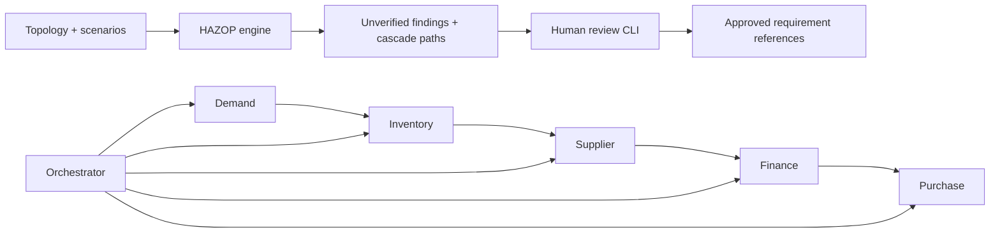

# Phase 1 repository inspection and architecture

This document retains the Phase 1 baseline. Current execution uses the [Phase 2 gateway](GOVERNANCE_ARCHITECTURE.md); Phase 1 analysis contracts remain unchanged.

Initial inspection on 2026-10-20 found Git metadata and no source, manifests, tests, or application documentation. No existing application behavior was removed. The user-supplied AGENTS instructions govern this implementation.

## Phase 1 layout

| Location | Responsibility |
| --- | --- |
| `packages/engine/aps/core.py` | Pure deterministic hazard generation, graph traversal, validation, deduplication, risk review and CSV export |
| `packages/engine/aps/cli.py` | File-based command line interface; errors return nonzero |
| `packages/simulator/src/` | TypeScript orchestrator and five fixed mock workers, with Node tests |
| `schemas/` | Strict Draft 2020-12 schemas for topology, hazard, report, scenarios and simulation receipt |
| `examples/` | Machine-readable procurement topology and 16 hand-authored reference scenarios |
| `tests/` | Python engine, workflow and contract tests |
| `scripts/verify.sh` | Repeatable tests, type checking, demo, schema validation and deterministic-output check |
| `artifacts/` | Generated local reports, simulation receipt and verification log; ignored by Git |

The Python engine consumes topology plus scenarios, emits an unverified report, then accepts explicit review commands to produce a new report. The simulator is separate: it demonstrates the modeled workflow and generates a receipt, but does not claim that simulated safeguards validate the hazard analysis. Python validates that receipt with the shared schema.

Workers communicate through sequential versioned shared state. Orchestrator delegation follows a fixed allowlist; a visited set and depth limit bound delegation. Tool names are checked against topology for the demo. Tools are in-process deterministic functions, not external adapters. Supplier content cannot become executable instructions. Finance produces an approval bound to supplier, quantity and quotation; purchase checks it before creating a `SIMULATED:` record. State updates use a version precondition; this is a single-process model of compare-and-swap, not a distributed consistency implementation. Idempotency is scoped to one simulation run.

Topology describes identities, objectives, permissions, tools, produced data, trust boundaries, constraints, communications, and state ownership. These declarations are analysis inputs. The simulator implements one fixed procurement model; it is not a general interpreter or enforcement runtime for arbitrary topology files. It does not dynamically execute tools named in JSON.

## Trust and extension boundaries

Schema validation is followed by semantic checks for graph references, node uniqueness, review history, assessment consistency, requirement derivation and cascade references. No network client, payment API, purchase API, credential store, LLM call, or autonomous scheduling is implemented. Installation needs a package registry; runtime does not.

The local review mechanism records a human's attestation, actor name, UTC timestamp, rationale and rating snapshot. It is not authenticated identity, signed evidence, or a tamper-proof ledger. Anyone able to edit local files or code is within the trusted operator boundary. A fabricated complete audit trail cannot be distinguished cryptographically from a genuine one. Production identity, signed events, persistent multi-user authorization, integrations and Phase 2 are out of scope.
