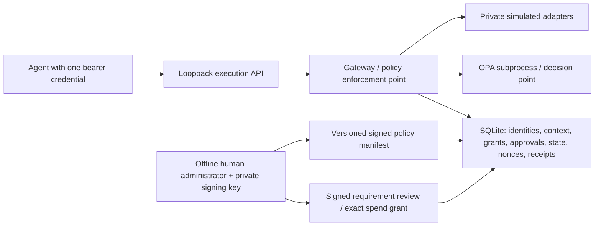

# Phase 2 authorization architecture

## Decision and repository boundaries

Phase 1's hazard engine, ID algorithm, report fields, reference topology, and five original schemas are unchanged. The TypeScript `simulate()` API still returns the original simulation receipt contract. Its actuation code is now a client adapter to a separate trusted Python runner; no TypeScript mock can submit an order directly.

OPA/Rego was chosen because OPA 1.20.2 is available in this environment and it can run as a bounded subprocess without a new Go/Rust service or embedded language binding. Python already provides schema validation and SQLite; TypeScript remains the swarm-facing client. Cedar would also support authorization, but would require another runtime/SDK here. The implementation uses real Rego evaluation, not a Python reimplementation of the policy. See the official [OPA CLI](https://www.openpolicyagent.org/docs/cli) for strict built-in error and timeout flags, and [policy language](https://www.openpolicyagent.org/docs/policy-language) for default rules. Policies are loaded into a frozen in-memory snapshot, evaluated from a private temporary file, and identified by the digest of Rego source plus configuration.

## Trust boundaries and credential scope

The agent-facing API is `POST /v1/call` on `127.0.0.1`. It has no policy, approval, task-provisioning, or direct-adapter endpoint. A random bearer token authenticates one agent; only its SHA-256 hash is stored. The body actor must match the authenticated actor. Each agent has a separately provisioned credential file. Tokens never appear in receipts or default logs. The default CLI runtime directory is private and key files use exclusive creation with mode 0600.

The offline administrator owns an Ed25519 private key outside the runtime directory. The execution process reads its pinned public key, not its private key. The gateway owns a different Ed25519 receipt key. A compromised receipt key does not permit policy or human-grant signing. A system administrator able to modify the gateway, keys, database or configured OPA binary is inside the trusted computing base.

This repository demonstrates an API/process boundary, not OS confinement. Deploy agents under an identity that cannot read/write the gateway state, policy administration key, other agents' credentials, or server code. The integration runner is a trusted fixture that provisions disposable credentials and speaks for the five workers; it is not an adversarial sandbox. Calling the Python library from an unrestricted same-user process is not a security boundary. All procurement effects remain local `SIMULATED:` records.

## Request-to-effect protocol

1. The HTTP adapter bounds requests to 16 KiB, rejects ambiguous transport and duplicate JSON keys, and schema-validates the request. No unstructured claim can supply approval or permissions.
2. The gateway starts a SQLite `BEGIN IMMEDIATE` transaction. It authenticates the caller, consumes a persistent actor/nonce pair, verifies the signed active policy manifest and matches it to the frozen evaluator snapshot.
3. It resolves the task, exact resource, opaque context reference and server-issued capability. A context must match task, trusted fixture-loader provenance and expiry. Agent-provided context strings are references only; no prompt content or self-generated approval is treated as authority.
4. It checks idempotency conflicts, derives delegation depth and builds typed policy facts from server state. Rego applies explicit denials before `review_required`; allow requires complete positive scope checks. Undefined/malformed decisions, exceptions, timeouts and unavailable OPA deny with no mock execution.
5. The selected private adapter executes inside the same transaction. Adapter inputs must match the fixed contract: demand equals the admitted task input, other worker payload values are zero, target is empty except for delegation, supplier and unit price are fixed mocks. Agents cannot choose arbitrary tools or pass additional instructions.
6. The gateway validates the resulting state, records the idempotency result, signs a receipt, and persists it atomically with the state/effect. Signing, validation, or persistence failures roll back. Response delivery happens after commit. Retrying after a lost response uses a fresh nonce with the same idempotency key and action content.

Holding the transaction across OPA eliminates local state-check/commit races at the cost of serialization. An OPA subprocess has a 500 ms evaluation limit and a 1 s outer timeout; SQLite lock acquisition waits up to 5 s. These are not end-to-end real-time guarantees. HTTP socket reads have a 2 s timeout; client calls have a 5 s timeout. No distributed lock, external side-effect transaction or multi-replica consensus is claimed.

## Identities, capabilities and duties

| Identity | Tool allowlist | Authority |
| --- | --- | --- |
| orchestrator | delegate_mock | Issue each worker one task capability; cannot spend or approve |
| demand | demand_mock | Publish admitted demand only |
| inventory | inventory_mock | Derive replenishment from authoritative task state |
| supplier | supplier_mock | Return fixed eligible sandbox supplier and quotation |
| finance | finance_mock | Request gateway-generated purchase approval after policy evaluation |
| purchase | purchase_mock | Submit exactly the approved simulated order |

Only the orchestrator receives a root capability (depth 0). Worker grants derive depth 1 from the server's parent grant and are task-bound, non-renewable and expiring. Workers cannot redelegate. The policy ceiling is 3; the implemented topology uses a stricter one-hop tree. Client depth fields must equal the stored grant; clients cannot self-declare shallower ancestry. The legacy `simulate({depth})` argument remains a compatibility preflight check; it cannot widen server-issued capabilities.

The stage machine enforces demand → inventory → supplier → finance → purchase. Version checks reject stale state. Finance and purchase have disjoint credentials and tools, and the approval issuer must differ from the purchase actor. No agent credential can administer a policy or grant a human exception.

## Financial and transaction controls

Amounts are integer sandbox currency units; no currency conversion exists. The v1 task budget and cumulative policy cap are both 1000. Approval up to and including 500 can proceed through the finance worker's gateway-mediated request; amounts above 500 return `review_required`. Above either spending cap is an unconditional denial, even with human approval. State and budget updates are atomic.

Finance approval is a gateway-owned record bound by SHA-256 to purchase identity, task, resource, action, supplier, quantity, amount, purchase state version 4, context reference and policy digest. It expires after 60 s or at task expiry, whichever comes first, and is consumed by purchase. A copied authorization display string does not authorize anything. Purchase requires the server record, exact state and binding. Policy changes invalidate existing approvals.

Nonce uniqueness rejects exact replays persistently, including across restarts. Idempotency is scoped by task/actor/key. An identical retry with a fresh nonce returns the original state result without another effect; the new receipt has `cached=true, executed=false`. Changed content under the same key is denied. Cache lookup does not bypass authentication, context, capability, task lifetime or current policy verification; expired purchase approval also blocks cached retrieval. Cached retrieval deliberately bypasses stage/version re-execution checks because it performs no action. Per-task orders and spend survive restarts.

The current offline provisioner creates one task/identity set per sandbox database. Use separate databases for independent demonstrations. Organization-wide budgets, multi-task scheduling and multi-currency accounting are not implemented.

## Review and escalation

`deny` performs no tool action. Correcting a request requires a new nonce and any missing authority must come from the administrator. `review_required` also performs no action and creates a pending task review with a 120 s deadline. It never promotes itself to allow. An external human administrator must approve the exact finalized purchase with the offline CLI. The signed human grant expires within 60 s, task lifetime and review deadline. Agents cannot upload such grants.

If the pending deadline expires, the next call marks the review `escalated` and denies the task; late approval is rejected. There is no automatic fallback approver, deadline extension or notification transport. An operator must inspect the recorded review state and provision a new task after resolving the cause. A policy outage produces `policy_unavailable_or_error`; a storage/signing failure returns HTTP 503 with a schema-valid non-authorizing error. Such an outage may prevent a durable receipt from being recorded. It must never result in a fabricated signed allow decision.

## Receipts and their limits

`authorization-receipt.schema.json` binds authenticated actor, canonical exact request hash, task, resource, action, policy version/digest, decision/reason, execution/cache flags, result hash, issue time and key ID. Each Ed25519 signature covers all those fields and the previous receipt hash. Malformed wire JSON is bound through an SHA-256 digest of its bytes inside an invalid-input marker. Parsed structured requests are canonicalized, so insignificant JSON whitespace is not part of their identity.

`verify-receipts` validates schema, public-key signatures, sequence and hash chain. Compare a result with `result_hash` and the original request with `request_hash` when auditing an individual action. Signatures and chaining detect tested modifications, reordering and interior deletion when the complete chain is available. They do not prove that an action was safe, correctly modeled, or approved by a competent reviewer. The gateway can sign an incorrect decision if compromised. Tail truncation or whole-database rollback requires an independently retained chain head/count to detect; external anchoring, key rotation and hardware-backed keys are not implemented.

## Policy administration and traceability

Source-controlled policy candidates live under `policies/v1/`; new versions use a new directory and unique config version. Offline administration signs a manifest binding exact policy, traceability and policy-simulation digests. Used version IDs cannot be reused. The gateway rejects any active manifest that differs from its loaded snapshot; after activation restart it with the new bundle. Previously issued policy-bound approvals cannot carry over.

A one-time, explicitly labeled `sandbox_baseline` bootstrap installs the engineering baseline for demonstrations. It does not approve any hazard or requirement and cannot overwrite an active policy. All later activation requires independent human attestation, signed approved requirements for every selected trace row, and passing allow/deny policy simulation evidence. Empty trace selection is permitted but makes no hazard coverage claim.

Trace proposals cover all 16 curated references plus every approved Phase 1 hazard, including non-reference findings. IDs link to unchanged Phase 1 hazard IDs; hazard and report digests prevent silently changing the study under a requirement. Requirement revisions increment a version, link the previous digest, and clear approvals. Only a Phase 1 `approved_requirement` finding can be promoted into a signed Phase 2 requirement. Implemented controls link source and test names; broad hazards without direct coverage carry explicit gaps. An implementation link alone is not an effectiveness claim.

Phase 1 review is still an unauthenticated local attestation; the Phase 2 admin key authenticates the trusted operator who endorses it. No real findings were human-reviewed or approved during development. Synthetic human approvals exist only in tests, not the generated report or proposal matrix.
